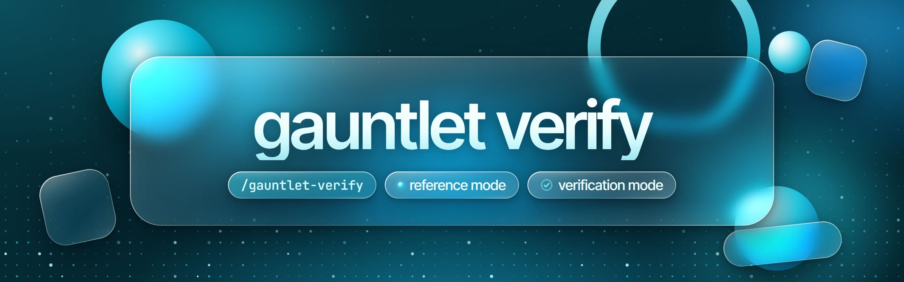
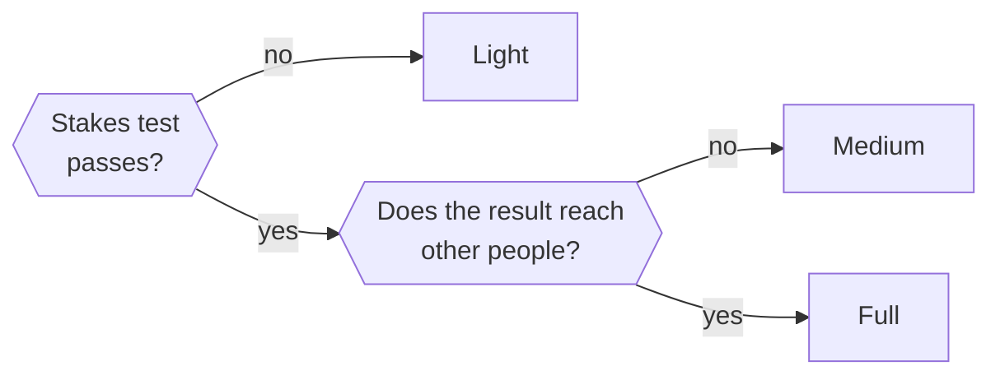
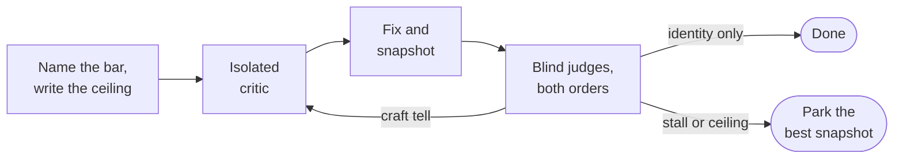
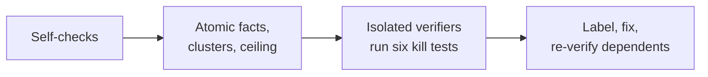

<div align="center">



<h1>gauntlet-verify</h1>

<p><b>A Claude skill for work that cannot afford to be mediocre or wrong.</b></p>

<p>
<a href="https://github.com/EauDoon/gauntlet-verify/actions"></a>
<a href="https://github.com/EauDoon/gauntlet-verify/blob/main/LICENSE"></a>
<a href="https://github.com/EauDoon/gauntlet-verify"></a>
</p>

<p>
<a href="#quick-start">Quick&nbsp;start</a> ·
<a href="#how-it-decides">How&nbsp;it&nbsp;decides</a> ·
<a href="#three-formations">Formations</a> ·
<a href="#reference-mode">Reference&nbsp;mode</a> ·
<a href="#verification-mode">Verification&nbsp;mode</a> ·
<a href="#tested-on-04-11-2026">Test&nbsp;results</a> ·
<a href="#evidence-behind-the-rules">Evidence</a>
</p>

</div>

<table>
<tr>
<th width="50%">Reference mode</th>
<th width="50%">Verification mode</th>
</tr>
<tr>
<td valign="top">Point it at a shipped thing you want to match. It runs an isolated critic and blind judges until the judges can tell your build from the original only by brand, age, or adoption, never by craft.</td>
<td valign="top">Point it at research that has to be right. It seats agents that never saw your reasoning, has them try to kill every load-bearing claim, and ships each claim labeled verified, reported, or unverified.</td>
</tr>
</table>

Spend has three levels. **Light** is the default. **Medium** runs when being wrong costs you, and only you act on the result. **Full** runs when the result goes public or to another party.

The Gauntlet Loop is [Matt Shumer's](https://github.com/mshumer) technique. This repo forks [robonuggets/gauntlet-loop](https://github.com/robonuggets/gauntlet-loop) and rebuilds it for day-to-day use.

## Quick start

It needs an agent that can run subagents or fresh contexts (sequential works), a browser or screenshot tool when the reference is a live page, and web access for verification mode. Every run writes a ceiling, in rounds or tokens, before it spends.

```bash
git clone https://github.com/EauDoon/gauntlet-verify
```

For every project (personal skills):

```bash
mkdir -p ~/.claude/skills && cp -r gauntlet-verify/.claude/skills/gauntlet-verify ~/.claude/skills/
```

For one project:

```bash
mkdir -p your-project/.claude/skills && cp -r gauntlet-verify/.claude/skills/gauntlet-verify your-project/.claude/skills/
```

For the Claude apps, turn on code execution, download [gauntlet-verify.zip](https://github.com/EauDoon/gauntlet-verify/releases/latest/download/gauntlet-verify.zip) from the latest release, and upload it under Customize > Skills. The apps trigger it from its description. To build the zip yourself, keep the skill folder at the zip root:

```bash
cd gauntlet-verify/.claude/skills && zip -r gauntlet-verify.zip gauntlet-verify
```

> [!IMPORTANT]
> The skill is named `gauntlet-verify`, so it installs beside upstream's `gauntlet-loop` without replacing it. Keep only one of the two enabled, or both may answer the same request.

In Claude Code, call it by name or just work. It fires on its own when a build in progress falls short of a named reference, and on heavy research where being wrong costs money or reputation, or the result feeds a public statement or a decision someone will act on.

```
/gauntlet-verify build me a pricing page as good as Linear's
```

```
dig into whether this protocol's fee revenue really passed its rival's, it goes in a public thread this week
```

```
medium gauntlet on the figures in this draft, full is overkill for this one
```

For a full-formation loop, the keyword `ultracode` in a typed prompt runs that one task as an orchestrated workflow; `/effort ultracode` does the same for the whole session. The keyword does not fire in `-p` runs or scheduled tasks, so a scheduled loop fans out with subagents instead.

## How it decides

The request picks the mode. The stakes, and who sees the result, pick the formation.

| | Reference mode | Verification mode |
|---|---|---|
| Fires when | A build in progress is not clearing a named, shipped reference | Several load-bearing facts, and being wrong costs money or reputation, or the result feeds a public statement or a decision someone will act on, or you ask for verification (light unless you name another formation) |
| The bar | A specific shipped artifact the build does not match today | The kill tests, run by agents that never saw the draft's reasoning |
| Seats | An isolated critic and blind judges; at full, a builder per area | The drafting session, then isolated verifiers |
| Stops when | Judges name only identity tells, the delta stops moving, you call it, or the ceiling hits | Every claim is killed, fixed, or labeled, or the ceiling hits |

A **seat** is one isolated agent role. A **formation** is how many seats a job gets. A **ceiling** is the budget in rounds or tokens, written down before any isolated seat is spawned.

## Three formations

Spend follows consequence. The stakes test decides between light and the rest; who sees the result decides between medium and full.



The stakes test: being wrong costs money or reputation, or the result feeds a public statement or a decision someone will act on. Your word overrides the formation in either direction, so a public thread can run at medium if you say medium.

| | Light | Medium | Full |
|---|---|---|---|
| **When** | Default, whenever the stakes test fails | The stakes test passes and the result reaches no one else: a decision only you act on. Or "medium gauntlet" | The stakes test passes and the result reaches other people: a public statement, or anything sent to a board, investor, client, or counterparty. Or "full gauntlet" |
| **Reference seats** | The drafting session builds; one isolated critic; one judge once the critic's findings stop dropping | The drafting session builds; one isolated critic; one judge every round, calibrated before round one | One builder per area on a cheaper workhorse model; one isolated critic; a panel of 2 to 3 judges every round, calibrated before round one |
| **Verification seats** | One isolated verifier for all claims | One isolated verifier per claim cluster, at most three; the smallest clusters merge | One isolated verifier per claim cluster |
| **Cost anchor** | 100k to 150k tokens, estimated, not a spending cap. The live tests below suggest this is low wherever each seat carries a large fixed context | Unmeasured, so the ceiling is written in rounds until three medium runs are logged. Two smoke runs on 04-11-2026 used about 655k (reference, 2 rounds) and 362k (verification, 2 rounds) subagent tokens | About 325k subagent tokens per round, measured once in reference mode before judges ran in both orders, which adds judge runs. Verification at full is unmeasured |

A claim cluster is the claims that rest on the same source set. Verification mode never seats a critic or judges. Full-formation judges come from at least two model families where the stack allows, because a same-family judge shares the priors that produced the gap. Builder fan-out and the judge panel are full-formation costs; medium buys a calibrated judge every round without them.

Escalation is automatic on stakes and audience, and always announced in one line. A loop can drop to light for a cleanup round. It never climbs silently.

## Reference mode

A rubric is a lossy compression of a reference. It works when the criteria are mechanical and fails when the quality is experiential: a page that feels expensive, a deck that lands, prose that does not read as generated. So the skill does not write criteria. It names an artifact that already clears the bar.



1. **Name the reference before building:** a specific shipped thing the build does not match today, the one property being matched, how the judge will see it, the formation, and the ceiling. "Linear's settings page" passes. "Good design" does not.
2. **Decompose:** split the build into areas that fail independently (structure, visual system, motion, copy, data, edge cases). Concerns that share one system, such as lighting and materials, are one area with one owner. At full, each area gets its own builder, and the orchestrating session assembles mechanically; anything it is tempted to patch goes back to that area's builder. At light and medium, the drafting session owns every area.
3. **Critic that never saw the build:** a fresh context with the artifact, the reference, the area names, and from round two the earlier snapshots. It names specific gaps, maps each to one area and one edit, and ranks by impact. No praise.
4. **Blind judge:** both artifacts, captured the same way and unlabeled. Each judge runs twice in fresh contexts, once in each order, because judges favor one position. At medium and full, each judge is first calibrated on the build as it stands, which misses the reference by definition; a judge that names no craft tell there cannot see the gap and is replaced. The judge is told one is the original and one is an attempt, then asked which is the attempt and what gave it away. At light, the judge runs once the critic's findings stop dropping.
5. **Loop and report the delta,** one line per round: the change in open craft tells and critic findings. Each round is snapshotted, and the critic rechecks areas that passed earlier against their snapshots, so a regression goes back to whoever caused it. A builder whose measurement contradicts a finding's edit reports it and closes the gap another way. Two rounds in a row with no drop in the combined count is a stalled loop; it stops and reports. On a Done verdict the judged snapshot ships; at any other stop the candidate is the best snapshot, not the last.
6. **You are the brake:** no round cap. A round that would pass the ceiling, judged by spend so far plus the last round's cost, does not start. The ceiling parks an unattended loop (you said not to check in, or it runs on a schedule), and it ships nothing on its own. Resuming past the ceiling is your call, and a new ceiling is written before the next round.
7. **Log the run:** one line in `logs/verification-runs.md` in the shared project folder, read back after the write, so cost estimates turn into measurements.

> [!TIP]
> Your own best past work is the strongest reference of all: it is inspectable, on-voice, and provably achievable.

### The judge question

Upstream asks which one is better. That invites diplomacy. Asking only which one the original author made fails differently: a famous original is recognized on sight, so the pick measures recognition, not the gap. The first measured run here hit that second failure. Now every tell the judge names is tagged.

| Tell | Meaning | Fixable |
|---|---|---|
| Craft | Something in the artifact itself: spacing, copy, motion, a broken example | Yes, it becomes next round's brief |
| Identity | Age, adoption, ecosystem, brand, the things a new artifact cannot have | No edit reaches it |

| Judge says | Read |
|---|---|
| Any judge, in either order, names a craft tell that matters | Not there |
| The only craft tells named do not matter | Close, press the one property |
| Every judge, in both orders, names only identity tells or none | Done, ship it; unattended, park it as ready |

A craft tell matters when a judge names it as what gave the attempt away, or it touches the one matched property. A wrong pick, no pick, or a split panel is not a pass on its own: judges often fail to tell real work from generated work while a gap remains, so only the tells count.

## Verification mode

The drafting session does its research and its own self-checks first. Then the skill writes a ceiling and seats verifiers. Each gets the claims, where each came from, and a short brief, never the reasoning that produced them. The design follows an observation, not a measurement, from the author's long multi-agent research builds: each layer caught errors in the one below it and added errors only the next one caught, and no layer's confidence predicted its accuracy.



The brief tells each verifier which claims are already labeled unsourced (declared, not defects), which self-checks ran (to re-run, not trust), and which primary-data tools it can load. Where a seat can be messaged twice, it answers the open questions before it sees the draft's values. Then each verifier runs the kill tests on every claim:

1. Answer the open question behind the claim from its own search, then search for the direct contradiction.
2. Trace to the primary source and quote the passage that states the claim with the same metric, period, and unit. A chain that ends at an aggregator, or a source on the topic that does not state the claim, leaves it unverified.
3. Recompute any number that can be recomputed.
4. Re-fetch every figure quoted from a live source and compare figure, source, and as-of date.
5. Check the date on every figure against its source's own publishing interval; where none is stated, flag the age.
6. Label it: **verified** (one tier A source, or two independent tier B), **reported** (a single tier B), or **unverified** (everything else, including anything resting on aggregators). Tier A is a primary source. Tier B is named-author reporting at an established outlet, or a counterparty document.

Claims are split into atomic facts first, one entity, figure, period, or definition each, and a claim is verified only if every fact is. Conflicting figures are never averaged, and an unresolved conflict leaves the claim unverified with both figures shown. A kill stands when its quote matches the claim's entity, metric, period, and unit; the drafting session may contest it once, and a fresh verifier given only the claim and both quotes settles it. A claim survives only if every test was run. A fix is re-verified along with every claim that rests on it. Unverified claims can still ship, labeled, with what would settle them. If no isolated verifier could run, the deliverable says so and the log records `not run`.

## The run log

Both modes append one line to `logs/verification-runs.md` in the shared project folder: `/mnt/project-files/` in a project thread, the connected folder in Cowork, or a durable project folder on other agents. The whole line goes in one write and is read back. A failed append or readback is reported; scratch files and built-in memory do not count. This repository keeps its own test runs in [logs/verification-runs.md](logs/verification-runs.md).

```text
DD-MM-YYYY | gauntlet-verify | mode | formation | artifact | reference or claim set | areas or clusters | rounds | tokens | judge or verifier trajectory
```

## Tested on 04-11-2026

The medium formation was tested before it merged, against a pass bar written before any run. The full record is in [audits/2026-11-04-live-evals.md](audits/2026-11-04-live-evals.md).

| Test | Result |
|---|---|
| Smoke test, reference mode, medium | A tldr-style page for `xz` driven at the tldr-pages `tar` page. The judge passed calibration and ran in both orders each round. In round 2 the critic's recheck found 5 regressions caused by round 1 edits. Craft tells fell from about 10 to 8 per order, and the 2-round ceiling parked the loop |
| Smoke test, verification mode, medium | 7 claims plus 1 derived claim on 4 source sets, merged onto 3 verifiers. Answering the open questions first caught a stale claim before the draft's values were shown. 2 kills, fixed and re-verified. Every claim ended unverified because the container blocked the primary hosts, and each label said so |
| Live behavior evals | 29 of 29 run passed: B1 to B26 plus four medium boundary cases. B12 did not run because the model's safeguards stopped that agent |
| Blind routing, two routers | 19 of 20 trigger cases on each. Both missed T13, an explicit request to verify with no stakes, because the description routes only research with stakes. The Opus router also loaded the skill for "medium gauntlet" on one tweet, which the skill then hands to a style edit |

> [!NOTE]
> In the test runtime, a judge with one tool call reported about 75k tokens, so seat count, not artifact size, drives the cost of a small job.

## What breaks it

- A reference nobody can show the critic. The critic invents one and approves everything.
- A critic or verifier that shares the builder's context. It inherits the builder's satisfaction.
- Asking "which is better", or only "which is the original". The first invites diplomacy; against a famous reference the second measures recognition.
- Stills for a motion property. The static frame converges while the real gap stays open.
- A pair captured differently, or judged in one order only. The judge spots the format or the position, not the craft.
- Parallel builders on one coupled system. In [Claude of Duty](https://github.com/mshumer/Claude-of-Duty#process-note), six parallel agents on lighting moved the score +0.46 while frame-ruining defects went from 60 to 66; one owner per coupled concern moved it +1.00 and cut them to 26.
- Shipping the last round by default. A fix can break an area that passed earlier; the best snapshot ships, not the latest. The 04-11-2026 smoke test saw 5 such regressions in one round.
- An assembler that quietly patches. The fix belongs to the area's builder, or the critic's findings stop meaning anything.
- Changing the artifact while the critic or judges are reading it. The verdict cannot be attributed to a version.
- Unpinned seats. Some orchestrators do not pass the session's model choice to subagents, so check the model each agent actually ran on.
- A verifier brief that lists tools without checking that the primary hosts are reachable. The verifiers fall back to search extracts, and every label ends unverified.
- Starting the loop and accepting round one. Fan-out prices for a single draft.
- Not logging. The next run pays for the same lesson.

## Measured so far

<details>
<summary><b>Every logged run, 08-08-2026 to 04-11-2026</b></summary>

<br>

| Date | Run | Result |
|---|---|---|
| 08-08-2026 | Reference mode smoke test: a project README driven at [sharkdp/bat](https://github.com/sharkdp/bat)'s README, full formation | 1 round, 3 builders, 1 critic, 2 judges, about 325k subagent tokens, 8 minutes. Both judges NOT THERE, matching the critic. The critic caught an output block the assembler had doctored. The 400k ceiling parked the loop before round 2 |
| 08-08-2026 | Routing checks on earlier, longer descriptions, two blind seats | 23 of 24 correct, then 5 of 5 after a fix to the clause separating it from the research method. Measured on the earlier wording, not on this text |
| 29-09-2026 | One logged light skill test, including two additional test drives | About 750k subagent tokens over five leaves. This expanded run is not a baseline for a plain light run |
| 08-10-2026 | Trigger eval v2 on the author's separate installed copy, blind router | Loaded on both prompts: first on the build prompt, second behind the research method on the research prompt. Not measured on this repository's description |
| 04-11-2026 | Reference mode smoke test, medium: a tldr-style `xz` page driven at the tldr-pages `tar` page | 2 rounds, 1 critic per round, 1 calibrated judge in both orders per round, about 655k subagent tokens over 8 seat runs. Not there in both rounds; parked at the 2-round ceiling |
| 04-11-2026 | Verification mode smoke test, medium: a private emergency-fund placement note | 2 rounds, 3 verifiers over 4 clusters, about 362k subagent tokens. 2 kills; every claim unverified, with the primary hosts blocked |
| 04-11-2026 | Live behavior evals and blind routing on this repository's description | 29 of 29 run behavior cases passed; routing 19 of 20 on both an Opus and a Sonnet router |

</details>

Light and medium costs stay estimates until three runs of each are logged; 150k is not a spending cap. Full verification mode remains unmeasured. Use the log to replace each placeholder after three runs of that formation and mode.

## Evidence behind the rules

<details>
<summary><b>The 03-11-2026 rules and the research behind each</b></summary>

<br>

They were checked through abstracts, summaries, and the repositories themselves, not full paper text.

| Rule | Source |
|---|---|
| Each judge runs in both orders, on a pair captured the same way | Zheng et al., "Judging LLM-as-a-Judge with MT-Bench and Chatbot Arena", NeurIPS 2023; Wang et al., "Large Language Models are not Fair Evaluators", arXiv 2305.17926 |
| A wrong pick, no pick, or a split panel is not a pass; only tells count | Clark et al., "All That's 'Human' Is Not Gold", ACL 2021; Rathi et al., arXiv 2407.08853 (displaced Turing test judges) |
| Judges are fresh each round and never see earlier verdicts | Pan et al., "Spontaneous Reward Hacking in Iterative Self-Refinement", arXiv 2407.04549 |
| Snapshot every round, recheck passed areas, keep the best snapshot | Huang et al., "Large Language Models Cannot Self-Correct Reasoning Yet", ICLR 2024; [Claude of Duty process note](https://github.com/mshumer/Claude-of-Duty#process-note), 25-07-2026 |
| One owner per coupled system; the builder owns the diagnosis | Claude of Duty process note |
| Claims split into atomic facts | Min et al., "FActScore", EMNLP 2023; Wei et al., "Long-form factuality in large language models" (SAFE), NeurIPS 2024 |
| The source must state the claim with the same metric, period, and unit | Liu, Zhang, and Liang, "Evaluating Verifiability in Generative Search Engines", Findings of EMNLP 2023 |
| A kill must match the claim and can be contested once | Wang et al., "Factcheck-Bench", Findings of EMNLP 2024 |
| Each judge is calibrated before round one at medium and full | Russell, Karpinska, and Iyyer, "People who frequently use ChatGPT for writing tasks are accurate and robust detectors of AI-generated text", ACL 2025 (detection skill varies widely between judges) |
| The verifier answers the open question before comparing | Dhuliawala et al., "Chain-of-Verification Reduces Hallucination in Large Language Models", Findings of ACL 2024 |
| Instructions stay under 20,000 bytes | Claude Code docs, [skill content lifecycle](https://code.claude.com/docs/en/skills) |

</details>

## Maintaining the skill

- Keep the description under 450 characters and lead with the trigger phrases. Skill listings have a character budget; in Claude Code it scales with the context window, and on overflow the least-used skills lose their descriptions first and keep only their names.
- Verification mode knowingly risks collisions with the research method and the rubric review. If a request misroutes, add or sharpen a clause in the description that separates this skill from the one that took it. The open case is T13: an explicit request to verify, with no stakes, does not route today.
- Keep the instructions, everything in SKILL.md before its `## Eval` section, under 20,000 bytes. After a conversation compacts, Claude Code re-attaches only the first 5,000 tokens of each invoked skill ([skill content lifecycle](https://code.claude.com/docs/en/skills)), and 20,000 bytes is about 5,000 tokens at an estimated 4 bytes per token. Past that point an instruction is lost mid-loop. The instructions are 19,874 bytes as of 04-11-2026, so the next addition needs a matching cut. Rationale and dated measurements belong in this README, not in the skill.

`scripts/check_skill.py` enforces the description and size limits. `npm run evals` checks that every eval case's required sentence is in the skill, and `evals/mutation.test.mjs` checks that each case fails when its sentence is removed.

## What changed from upstream

<details>
<summary><b>This fork against <a href="https://github.com/robonuggets/gauntlet-loop">robonuggets/gauntlet-loop</a>, row by row</b></summary>

<br>

| | Upstream | This fork |
|---|---|---|
| Output | One paste-ready loop prompt, with an offer to run it here | Runs the loop in the current session |
| Modes | Build to a bar | Reference mode, plus verification mode for facts |
| Bar | Named, fetchable, comparable | Same, plus not matched today and one property at a time; your own past best counts |
| Judge question | The critic picks which one is better | Which one is the attempt, with every tell tagged craft or identity |
| Spend | Fan out every time; a budget line only if the user names one | Light, medium, or full formation set by stakes and audience; a ceiling always written first |
| Stop | Ours wins the blind comparison, or the user stops | Only identity tells remain, the delta stops, the user stops, or the ceiling parks it |
| Memory | None | One log line per run, so estimates become measurements |
| Skill name | `gauntlet-loop` | `gauntlet-verify`, so it does not overwrite upstream |

</details>

## Repo layout

<details>
<summary><b>Files and folders</b></summary>

<br>

```
.claude/skills/gauntlet-verify/
└── SKILL.md              # the whole skill, one file
.github/
├── ISSUE_TEMPLATE/       # bug report and feature request forms
├── PULL_REQUEST_TEMPLATE.md
└── workflows/check.yml   # structural check, unit tests, and evals on main and pull requests
evals/
├── README.md             # trigger and behavior cases, run by hand in a fresh session
├── cases/                # B1 to B26 behavior and T1 to T20 trigger cases as JSON
├── runner.mjs            # npm run evals: checks each case's phrases against SKILL.md
└── *.test.mjs            # runner, case file, README sync, and mutation tests
scripts/
├── check_skill.py        # frontmatter, size, dash, link, and claim label checks
└── test_*.py             # unit tests for check_skill.py and the CI workflow
logs/
└── verification-runs.md  # one line per logged run of this repository's own tests
audits/                   # dated audit reports, including the 04-11-2026 live evals
assets/
├── banner.jpg
└── src/banner.html       # banner source
CHANGELOG.md
LICENSE                   # CC BY 4.0
README.md
SECURITY.md               # how to report a flaw
package.json              # npm test and npm run evals
.gitattributes            # LF line endings
.gitignore
```

</details>

## Credit

The Gauntlet Loop technique is **[Matt Shumer's](https://github.com/mshumer)**. He ran it in the [prompt](https://github.com/mshumer/Claude-of-Duty/blob/main/prompt.md) behind [Claude of Duty](https://github.com/mshumer/Claude-of-Duty) and named it in [his write-up](https://somethingbig.ai/gauntlet-loop) on 27-07-2026. The harsh critic, the blind side-by-side comparison, and the refusal to stop until the work holds up all come from that prompt.

The original skill packaging is by Jay E at [RoboNuggets](https://robonuggets.com), in [robonuggets/gauntlet-loop](https://github.com/robonuggets/gauntlet-loop). This fork changes it substantially; see [CHANGELOG.md](CHANGELOG.md).

Related reading: [Anthropic on building effective agents](https://www.anthropic.com/engineering/building-effective-agents) covers the evaluator-optimizer workflow. The loop applies it to bars that cannot be written as criteria.

## License

[CC BY 4.0](LICENSE), as upstream. Free to use with attribution.
